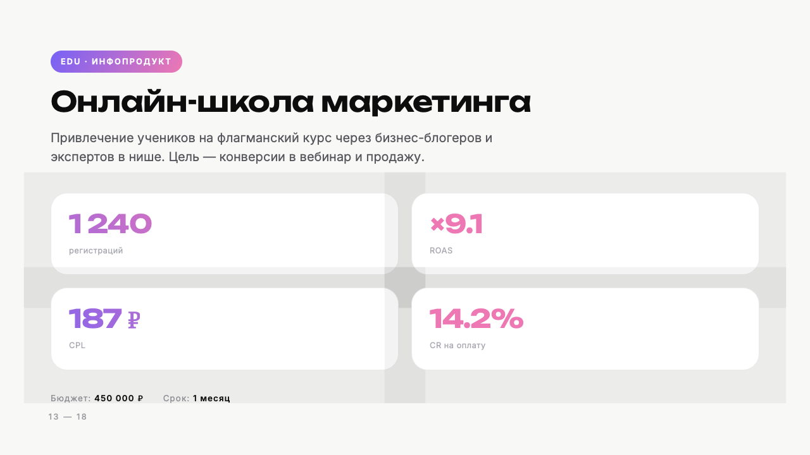

# Кейс: почему PDF ломался ровно на 7 слайдах из 18

**→ [Полная версия кейса с дизайном](https://vreklameblogers-max.github.io/mediacentr-presentation-case/) · [Живая презентация](https://vreklameblogers-max.github.io/mediacentr-presentation-case/presentation/) · [PDF](presentation/Медиацентр_презентация+кейсы.pdf)**

Презентацию агентства «Медиацентр» правили несколько раз подряд: номер слайда «наезжал» на контент на слайдах 6, 8–11, 12, 13, а после ручной починки та же проблема возвращалась при следующем экспорте. Разбор показал, что дело не в вёрстке конкретных слайдов, а в одном непросуженном media-запросе, который делал экспорт непредсказуемым.

## Задача

| Баг | Симптом | Где |
|---|---|---|
| Нумерация наезжает на контент | Номер страницы перекрывается плотными сетками (метрики, шаги процесса) | слайды 6, 8, 9, 10, 11, 12, 13 |
| Обрезанный градиент | Слово с градиентной заливкой обрывается в macOS Preview | слайды 1, 3, 5, 11–13, 16 |

<table>
<tr>
<td><br><sub>До — слайд 13, номер перекрывает «Бюджет»</sub></td>
<td><br><sub>После — ничего не перекрыто</sub></td>
</tr>
<tr>
<td><br><sub>До — слово «системе» обрезано</sub></td>
<td><br><sub>После — градиент цел</sub></td>
</tr>
</table>

## Диагностика

Точечная правка каждого слайда ничего не давала — проблема возвращалась после следующего изменения текста. Значит, источник был не в контенте, а в общем правиле вёрстки.

1. Изучил структуру: один `index.html` на 18 слайдов, общий `styles.css`, три альтернативных сценария экспорта в PDF (headless Chrome, Playwright, Puppeteer).
2. Сопоставил список «сломанных» слайдов с версткой — все они держатся на плотных grid-сетках (`.process` на 7 колонок, `.case-metrics` на 4 колонки).
3. Нашёл общий знаменатель: мобильные брейкпоинты `@media (max-width:1024px)` / `(max-width:680px)` не были ограничены типом устройства — значит, срабатывали и в PDF, если «бумага» уже 1024 CSS-пикселей.
4. Подтвердил гипотезу: экспорт через диалог печати браузера (⌘P) даёт предпросмотр узкого «листа» → сетки схлопываются в 2 колонки → контент вырастает по высоте → упирается в колонтитул.

Второй, независимый баг — градиентный текст (`background-clip:text`) корректно рендерился в браузере, но Chrome печатает его в PDF как маску, а Quartz-рендерер macOS Preview обрабатывает такую маску иначе, обрезая буквы.

## Решение — правка архитектуры, а не отдельных слайдов

```diff
- @media (max-width:1024px){ ... }
+ @media screen and (max-width:1024px){ ... }   /* больше не сработает при печати */

  .mark{
-   left:clamp(28px,6vw,96px); bottom:clamp(22px,4vw,52px);
+   position:absolute; left:80px; bottom:34px;   /* фиксированные px, не vw */
  }

  .slide{
-   padding:64px 80px;
+   padding:56px 80px 96px;                       /* полоса под колонтитул */
+   justify-content:flex-start;
  }
  .inner{
-   /* центр через justify-content родителя */
+   margin-top:auto; margin-bottom:auto;          /* переполнение уходит вверх */
  }

  /* печать: сплошной цвет вместо градиентной маски-текста */
+ .grad{ background:none; -webkit-text-fill-color:#7B61FF; color:#7B61FF; }
+ .card,.light .card,.cm,.quote{ box-shadow:none; }
```

Плюс — единая точка экспорта: `presentation/export.sh` (headless Chrome) вместо диалога печати браузера, который и был источником нестабильной ширины «бумаги».

## Верификация

Не «выглядит нормально», а измерено — два независимых числовых теста:

```
$ python3 verify_marks.py

страниц: 18
размеры страниц: {(960.0, 540.0)}
Y-координата номера на всех страницах: {29.17}

✓ OK — единственное значение на 18 из 18
```

- **Координаты, не пиксели**: из PDF извлечены буквальные координаты номера страницы на всех 18 страницах (`pypdfium2`) — множество Y-координат схлопнулось в одно значение.
- **Тот же движок, что у Preview**: каждая страница отрисована через CoreGraphics (`sips`) — тем самым рендерером, которым сама macOS показывает PDF, а не приближением через сторонний просмотрщик.

## Результат

| 18/18 | 2 | 1 | 0 |
|---|---|---|---|
| слайдов с идентичной нумерацией | независимых бага устранены в архитектуре | команда для воспроизводимого экспорта | точечных правок отдельных слайдов |

## Стек

`HTML5` · `CSS Grid/Flexbox` · `Vanilla JS` · `Headless Chrome` · `Playwright` · `Puppeteer` · `pypdfium2` · `CoreGraphics (sips)`

## Структура репозитория

```
├─ presentation/            — сама презентация (18 слайдов, статика, без сборки)
│  ├─ index.html
│  ├─ styles.css            — печатный медиа-блок переписан
│  ├─ export.sh             — единая точка экспорта в PDF
│  ├─ export.py / export_node.js
│  └─ Медиацентр_презентация+кейсы.pdf
├─ case-media/               — скриншоты «до/после» для этого кейса
├─ index.html                — оформленная версия кейса (см. ссылку выше)
└─ README.md                 — этот файл
```

---

**Медиацентр** — реклама у блогеров, превращённая в систему. Подбор под KPI, проверка, согласование, контроль выхода и прозрачная отчётность.
📞 +7 926 477 73 40 · Telegram [@team_mediacenter](https://t.me/team_mediacenter) · [mediacentr.online](https://mediacentr.online)
